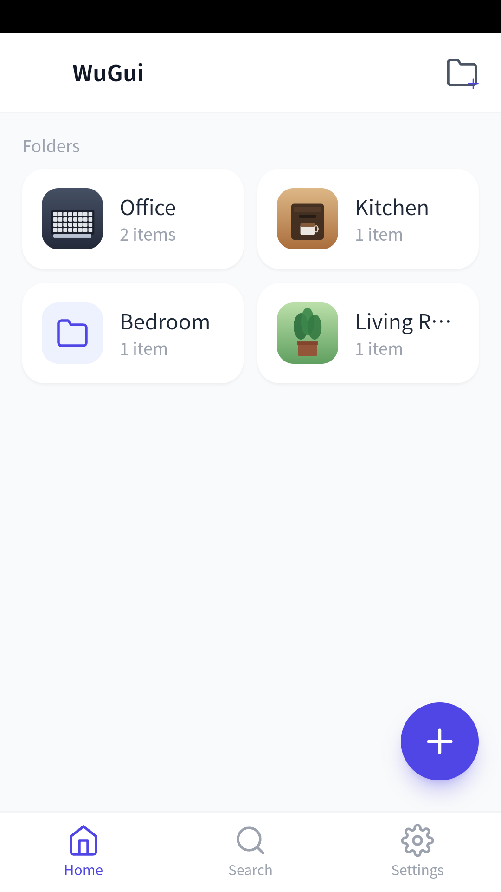
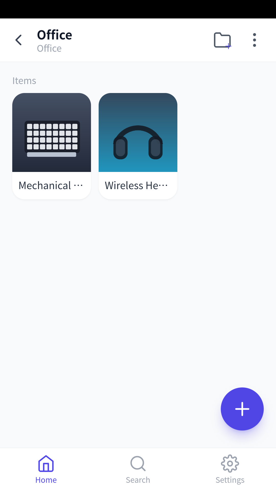
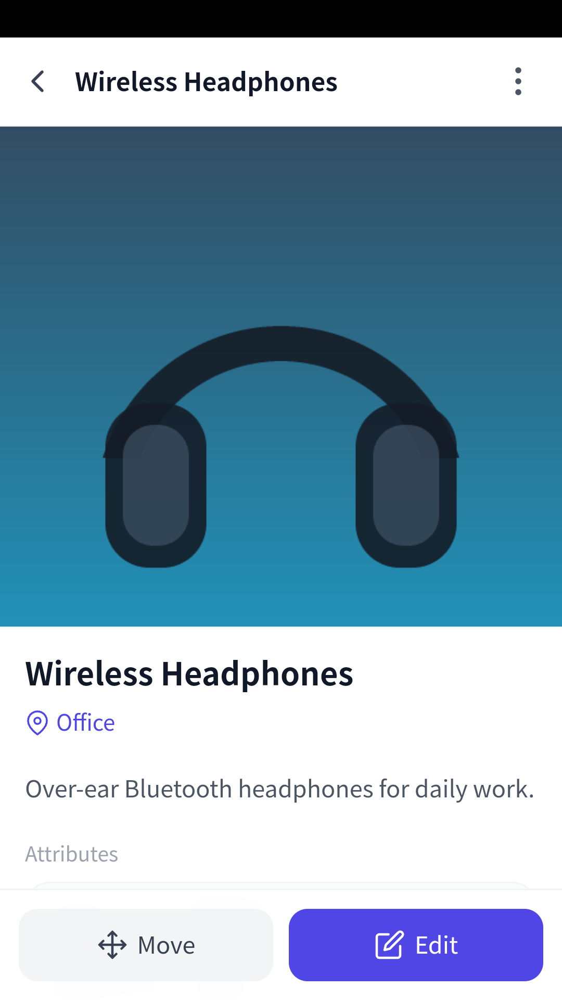
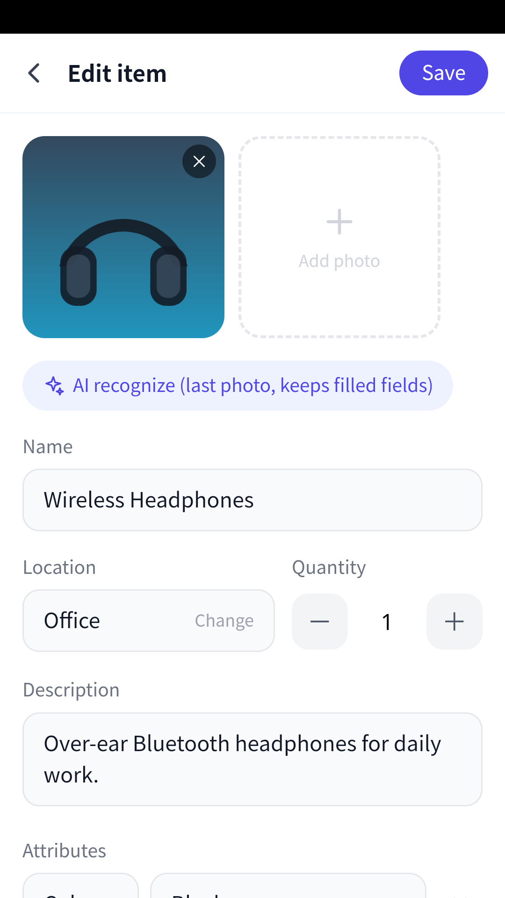
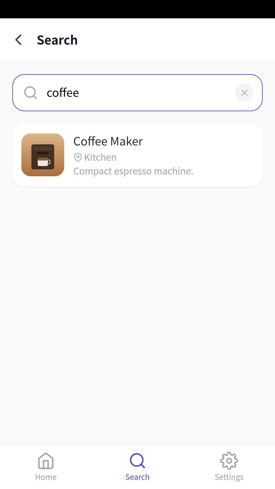

# WuGui (物归处)

English | [中文](README.zh-CN.md)

An offline Android app for tracking where your stuff is stored. Unlimited nested folders with optional cover images; items support multiple photos. Take a photo or pick from the gallery and AI auto-fills the name, suggested category, attributes and tags — editable before saving. Fully offline except for AI recognition; all data stays on the device.

**Highlights**: folder QR labels (print on a box, scan to open it) · pinyin + folder-name search · batch move/delete with undo · lend-out tracking · expiry reminders (30/7/1 days ahead + on the day, custom time) · dark mode · CSV inventory export · also runs as a PWA in the browser.

## Screenshots

| Home | Folder | Item Detail | Edit Item | Search |
| --- | --- | --- | --- | --- |
|  |  |  |  |  |

[中文界面截图](README.zh-CN.md#界面截图)

## Tech Stack

- Frontend: Vite + React 18 + TypeScript + Tailwind CSS
- Data: IndexedDB (Dexie); images stored locally as Blobs
- Shell: Capacitor 7 (`@capacitor/camera` for photos, `CapacitorHttp` to bypass WebView CORS, `filesystem` + `share` for backup export)

## Project Structure

```
src/
  db.ts            Dexie data layer (tree / items / undoable delete / pinyin search / backup / CSV)
  ai.ts            OpenAI-compatible vision recognition (image → structured JSON)
  image.ts         Client-side image compression (1024px full + 256px thumbnails)
  qr.ts            Folder QR label generation + jsQR decoding
  notify.ts        Local expiry reminders (@capacitor/local-notifications)
  theme.ts         Light / dark / system theme
  i18n.ts          i18next setup (zh / en)
  locales/         zh.ts, en.ts dictionaries
  store.tsx        Navigation stack (keep-alive, depth-capped) / toast with undo action
  ui.tsx           Icons, top bar, bottom sheets, dialogs, bottom nav
  CategoryPicker.tsx  Folder-tree picker sheet
  screens/         Browse, ItemForm, ItemDetail, Search, QrScan, Settings
scripts/make-icons.mjs  App icon generator (pure Node)
android/           Capacitor Android project
```

## Build the APK

Requires JDK 21 and Android SDK (platform 35). Paths are read from `JAVA_HOME`/`ANDROID_HOME` env vars, falling back to `.env` (gitignored local config):

```dotenv
# .env
JAVA_HOME=C:\Program Files\Java\jdk-21
ANDROID_HOME=C:\Android\Sdk
```

One-click build (Windows cmd):

```bash
npm install
build-apk.bat
# Output: android/app/build/outputs/apk/debug/app-debug.apk → copied to wugui.apk
```

Or step by step: `npm run build` → `npx cap sync android` → `cd android && gradlew assembleDebug`.

Unit tests (data layer, fake-indexeddb): `npm test`

### Release signing

For a release build, generate a keystore and drop a `keystore.properties` (gitignored) into `android/` — `build.gradle` picks it up automatically:

```bash
keytool -genkey -v -keystore android/wugui.keystore -alias wugui -keyalg RSA -keysize 2048 -validity 10000
cp android/keystore.properties.example android/keystore.properties  # fill in passwords
cd android && gradlew assembleRelease
```

## Languages

Chinese / English built in (react-i18next). Follows the system language by default; can be switched in Settings and persists across launches. AI recognition responds in the UI language. The launcher name shows as 物归处 / WuGui depending on system locale.

## AI Configuration

**No API URL, key or model is bundled in the source or APK.** On first use, open Settings and fill in Base URL / API Key / model (OpenAI-compatible API; a vision-capable model is required). Saved to localStorage on the device; the network is used only during recognition.

## Usage

1. Copy the APK to your phone and install (debug-signed; the "unknown sources" warning is expected).
2. Tap the folder+ icon (top right) to create folders — unlimited depth. The folder menu (⋯) supports rename / move / delete, a cover image shown in the parent folder, and a **QR label** to print on boxes — scan it (top-bar scan button) to jump straight into the folder.
3. Tap + (bottom right) → Snap & Identify / Gallery / Manual. Items support multiple photos — add or remove them freely.
4. Recognition auto-fills name / description / attributes / tags and suggests a category (tap to apply — folders are created automatically). The first photo auto-recognizes for new items; in edit mode use the manual button — filled fields are never overwritten.
5. Tap an item for details: swipe through photos, tap a tag to search it, mark items lent to someone, set an expiry date for local reminders 30/7/1 days ahead and on the day (days and time customizable in Settings). Deletes can be undone within a few seconds.
6. Search matches name (and **pinyin**), description, attributes, tags — and folder names. Batch-select items (long-press or "Select items") to move or delete them together.
7. Settings can export/import a JSON backup (photos included) and a CSV item list, switch language and theme.

## License

[MIT](LICENSE) — free to use, modify, distribute and sell; just keep the copyright notice.
