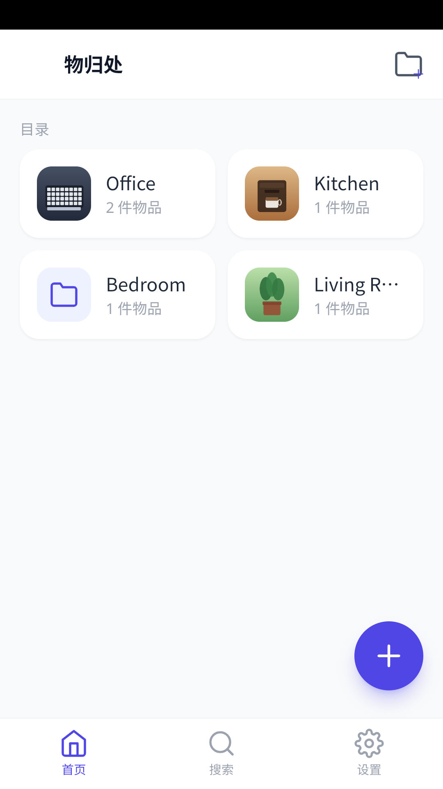
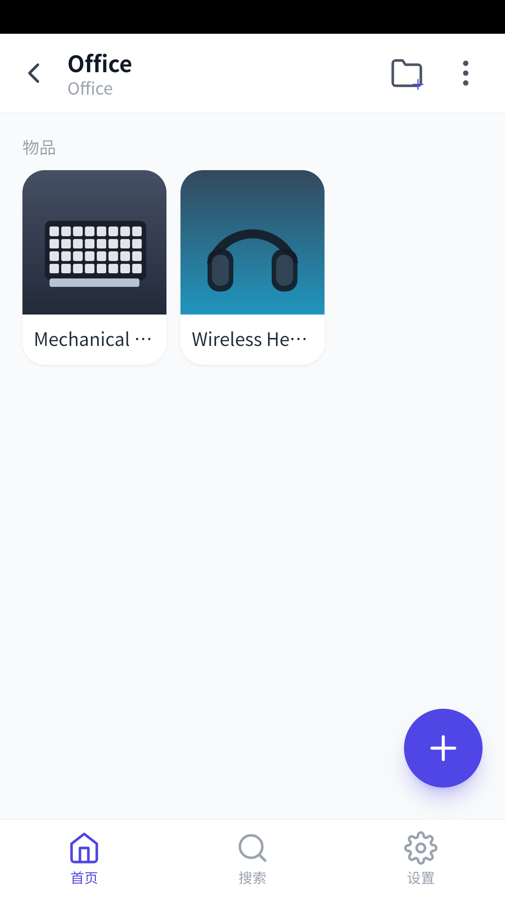
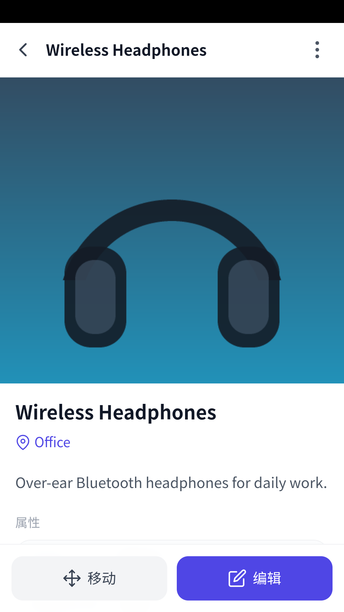
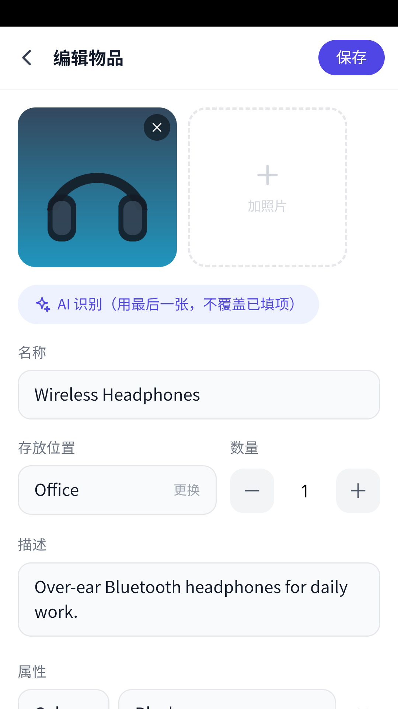
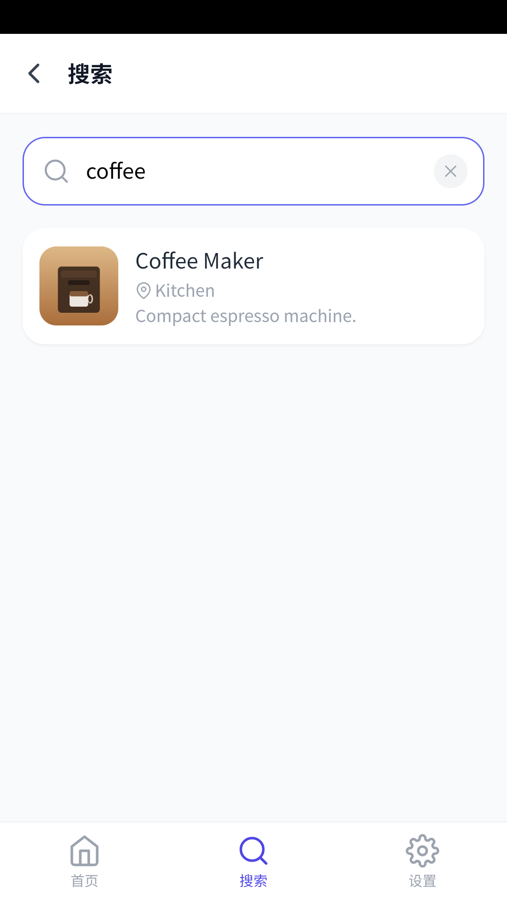

# 物归处

[English](README.md) | 中文

离线物品收纳管理 App（安卓 APK）。目录无限层级、可设封面图；物品支持多张照片；拍照/相册上传后 AI 自动识别物品名称、建议分类、属性并预填，可修改后保存。除 AI 识别外完全离线，数据全部存在本机。

## 界面截图

| 首页 | 目录 | 物品详情 | 编辑物品 | 搜索 |
| --- | --- | --- | --- | --- |
|  |  |  |  |  |

[English screenshots](README.md#screenshots)

## 技术栈

- 前端：Vite + React 18 + TypeScript + Tailwind CSS
- 数据：IndexedDB（Dexie），图片以 Blob 存本地
- 壳：Capacitor 7（`@capacitor/camera` 拍照、`CapacitorHttp` 原生转发请求绕过 CORS、`filesystem`+`share` 导出备份）

## 目录结构

```
src/
  db.ts            Dexie 数据层（目录树/物品/级联删除/搜索/备份导入导出）
  ai.ts            OpenAI 兼容接口识别（图片 → 结构化 JSON）
  image.ts         客户端图片压缩（最长边 1024，JPEG）
  i18n.ts          i18next 初始化（中/英）
  locales/         zh.ts、en.ts 文案字典
  store.tsx        导航栈 / Toast / 数据版本
  ui.tsx           图标、顶栏、底部面板、弹窗、底部导航等
  CategoryPicker.tsx  目录树选择弹层
  screens/         Browse 浏览、ItemForm 表单、ItemDetail 详情、Search 搜索、Settings 设置
scripts/make-icons.mjs  纯 Node 生成应用图标
android/           Capacitor Android 工程
```

## 构建 APK

需要 JDK 21、Android SDK（platform 35）。JDK/SDK 路径从环境变量 `JAVA_HOME`/`ANDROID_HOME` 读取，未设置时回退读 `.env`（gitignore 的本地配置）：

```dotenv
# .env
JAVA_HOME=C:\Program Files\Java\jdk-21
ANDROID_HOME=C:\Android\Sdk
```

一键构建（Windows cmd）：

```bash
npm install
build-apk.bat
# 产物：android/app/build/outputs/apk/debug/app-debug.apk → 复制为根目录 wugui.apk
```

或手动分步：`npm run build` → `npx cap sync android` → `cd android && gradlew assembleDebug`。

## 多语言

内置中文 / English（react-i18next），默认跟随系统语言，可在「设置」页手动切换并持久化。AI 识别的输出语言与界面语言一致；Android 启动器名称随系统语言显示「物归处 / WuGui」。

## AI 配置

源码与构建产物中**不含任何接口地址、密钥或模型默认值**——首次使用在 App 内「设置」页填写 Base URL / API Key / 模型（OpenAI 兼容协议，需支持图片输入的视觉模型），保存在本机 localStorage，仅识别时联网。

## 使用

1. 把 APK 传到手机安装（debug 签名，系统提示"未知来源"属正常）。
2. 首页右上角「目录+」建目录，层级不限；目录菜单（右上角 ⋯）可重命名/移动/删除，也可设置封面图（在父级列表中显示）。
3. 右下角 ＋ → 拍照识别 / 相册 / 手动填写；编辑/新建物品可添加多张照片，逐张删除。
4. 识别后自动填名称/描述/属性/标签，并给出建议分类（点击应用会自动建目录）；新建时首张图自动识别，编辑模式点按钮手动识别且不覆盖已填字段。
5. 点物品进详情：大图横滑浏览全部照片（带页码），可编辑、移动位置、删除；顶部搜索跨目录匹配名称/属性/标签。
6. 设置页可导出/导入 JSON 备份（含照片 base64），换机前先导出。

## 开源许可

本项目采用 [MIT License](LICENSE)——可自由使用、修改、商用和再分发，保留版权声明即可。
